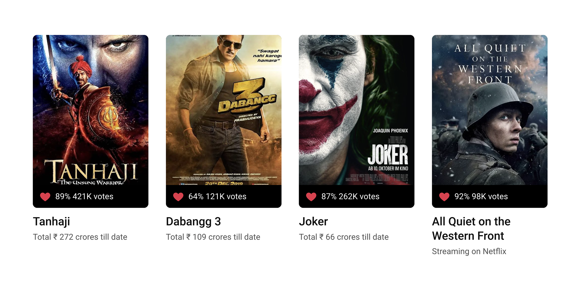
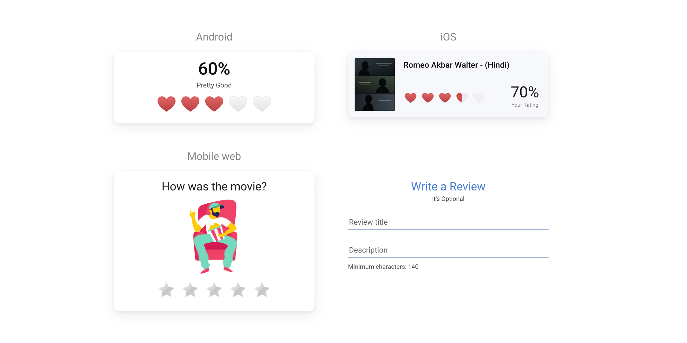
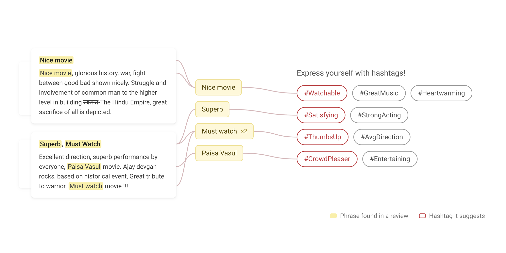
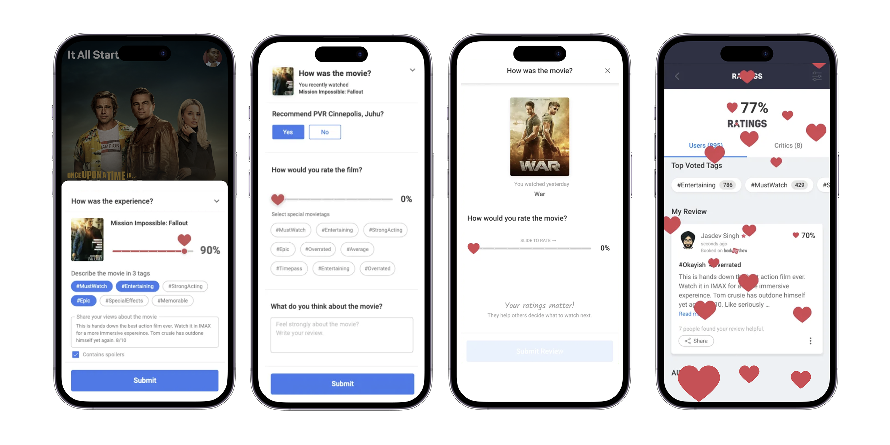
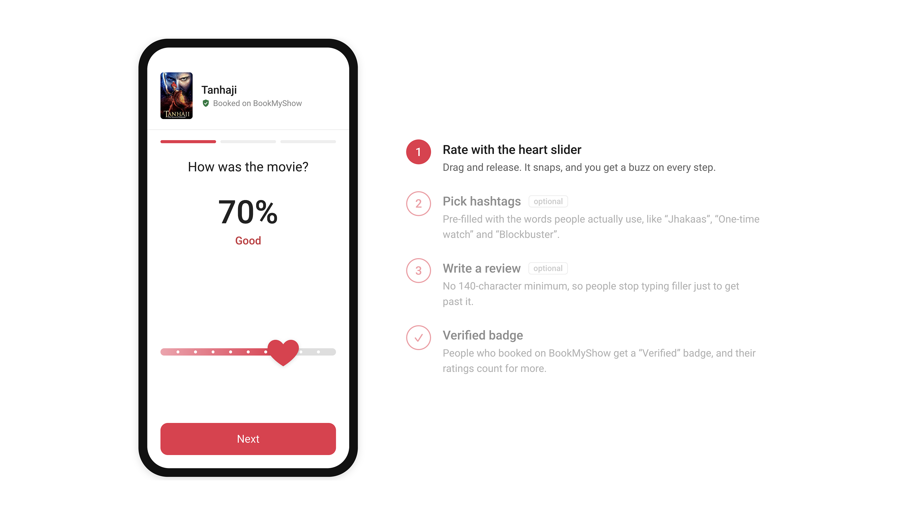
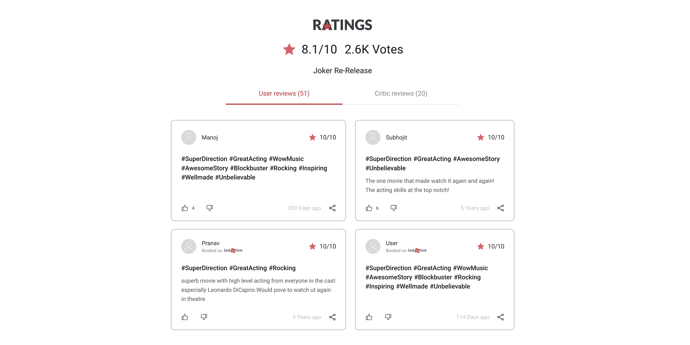
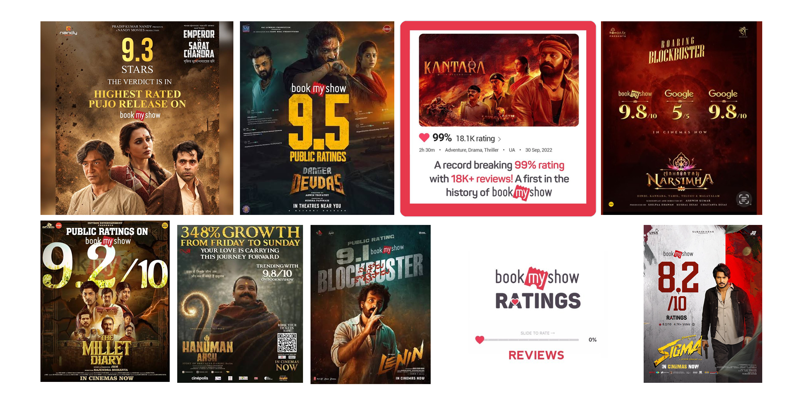

---
# Pulled from Notion "Patterns Work Blog Posts" (page 414226b9a26e8102819ceeb94a17de0a), 2026-11-10.
order: 5
client: BookMyShow
title: Reviews up 3x at BookMyShow, through pure design
description: "How we redesigned ratings and reviews at BookMyShow for 50M+ monthly users: a 10-second flow that grew reviews 24% in a month and written reviews 3x."
publishedDate: 2026-11-10
ogImage: ./bookmyshow-ratings-and-reviews-card.png
ogImageAlt: Reviews up 3x at BookMyShow, through pure design
logo: ./bookmyshow-logo.svg
industry:
  - Entertainment
duration: 3 months
scope:
  - User Research
  - Product Strategy
  - Product Design
impact:
  - "Time to submit a review dropped from 60s to 10s."
  - "24% more reviews in the first month."
  - "3x growth in meaningful written reviews."
about: "BookMyShow is India's leading entertainment ticketing platform, used by 50M+ people a month. In India, its movie ratings carry more weight than IMDb or Rotten Tomatoes."
situation: "Millions booked tickets, but few rated films. Reviewing took 60 seconds, with 10+ inconsistent rating icons and a forced 140-character minimum. Users said it took too long, they didn't know what to write, and doubted anyone would read it."
task: "Help people choose the right movie and contribute meaningful reviews once they've watched it. Grow reviews by 25%, cut the time to submit sharply, and keep usability satisfaction above 80%."
action: "We audited the old flows, listened to 1,400+ users and tested 30+ prototypes. The result was a 10-second, three-step flow with a heart slider, ready-made hashtags and an optional review, plus Verified badges for people who booked."
result: "Reviews rose 24% in the first month and meaningful written reviews grew 3x. Ratings were syndicated to Amazon India. BookMyShow now has the most ratings and reviews of Indian movies in the world."
---

