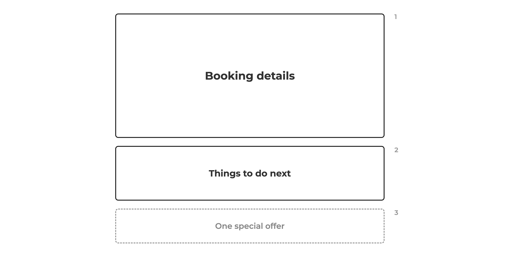
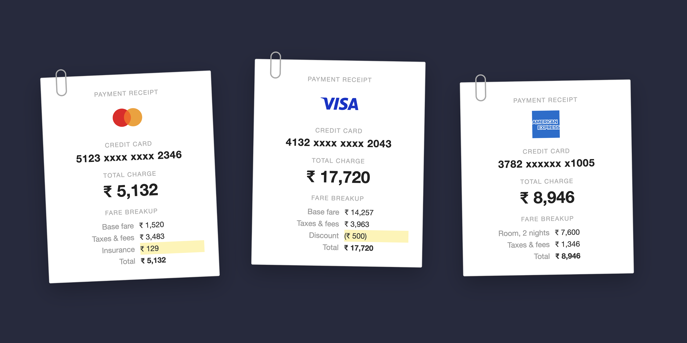
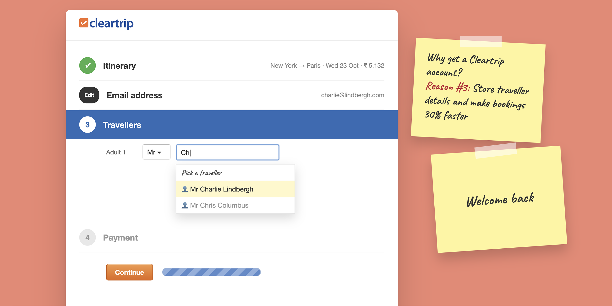
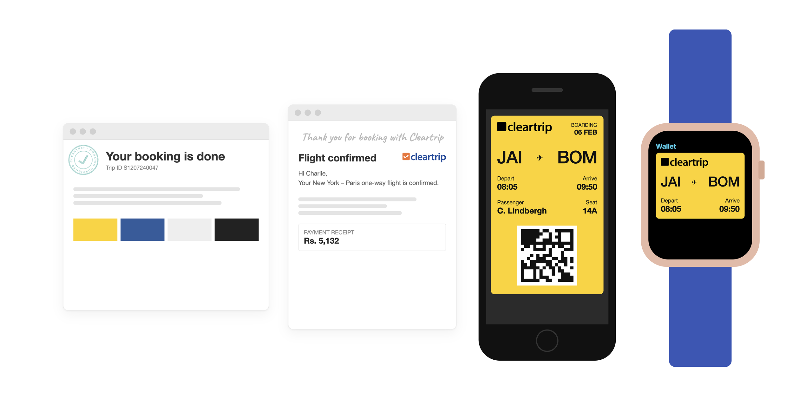
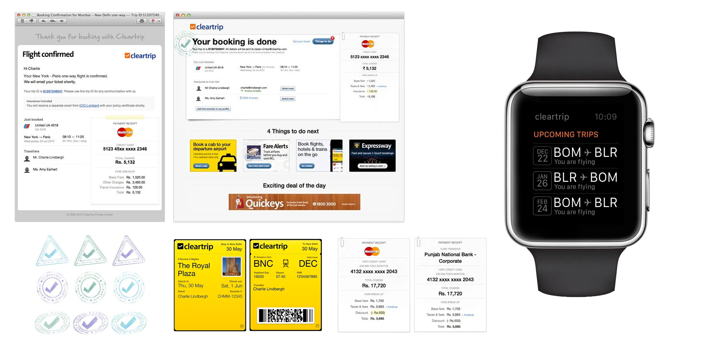
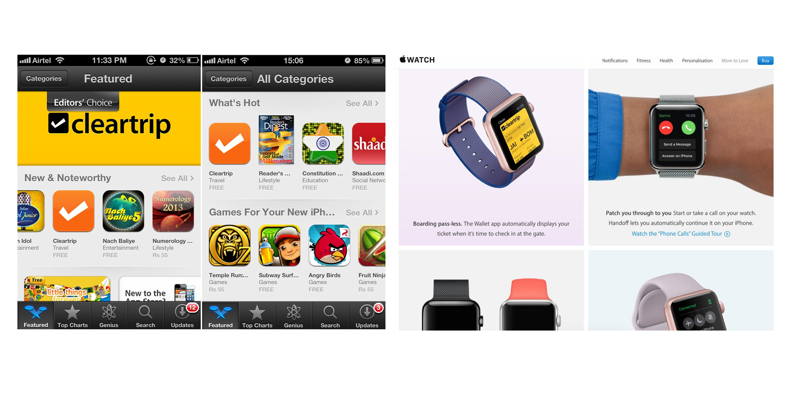

---
# Pulled from Notion "Patterns Work Blog Posts" (page 416226b9a26e803eb5d5c8034c7a49a9), 2026-11-12.
order: 5
client: Cleartrip
title: Why do customers love booking with Cleartrip?
description: "We redesigned Cleartrip’s confirmation page into three blocks: the booking as a boarding pass, four add-ons, one deal. Add-on bookings rose about 40%. The pass moved to Passbook and Apple Watch. The app was featured as Editors’ Choice."
publishedDate: 2026-11-12
ogImage: ./cleartrip-confirmation-page-card.png
ogImageAlt: Inside the Cleartrip booking flow that led to Apple’s Editors’ Choice
logo: ./cleartrip-logo.svg
industry:
  - Travel Tech
duration: 3 months
live: "https://www.cleartrip.com/"
scope:
  - Communication strategy
  - Product Design
  - Visual Design
impact:
  - "80% of customers came back to book again"
  - "About 30% fewer “is my booking confirmed?” support calls"
  - "About 40% more add-on bookings from the confirmation page"
  - "Featured as an Editors’ Choice app on the App Store"
about: "Cleartrip is an Indian online travel company, founded in 2006, that sells flights, hotels and trains. Flipkart acquired it in 2021."
situation: "In 2012, Cleartrip’s booking confirmation page had become a dumping ground. Over the years we had added offers and banners for everything else we sold, and the booking details were hard to find."
task: "We were redesigning the whole booking flow for flights and hotels. The confirmation page needed to show the booking clearly, offer a few relevant next steps, and stay uncluttered as new things got added later."
action: "We split the page into three fixed blocks: booking details, four add-ons such as a return-trip fare alert, and one deal of the day. Flight details used a boarding-pass layout with a rubber stamp. A receipt broke down the total cost."
result: "80% of customers came back to book again. About 30% fewer “is my booking confirmed?” support calls. About 40% more add-on bookings from the confirmation page. Featured as an Editors’ Choice app on the App Store."
---

