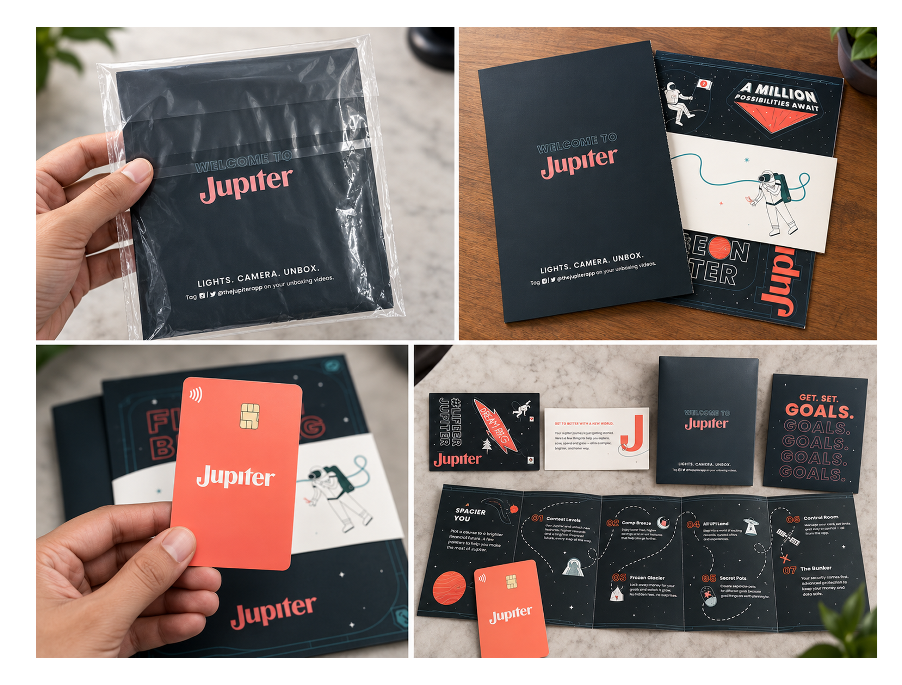
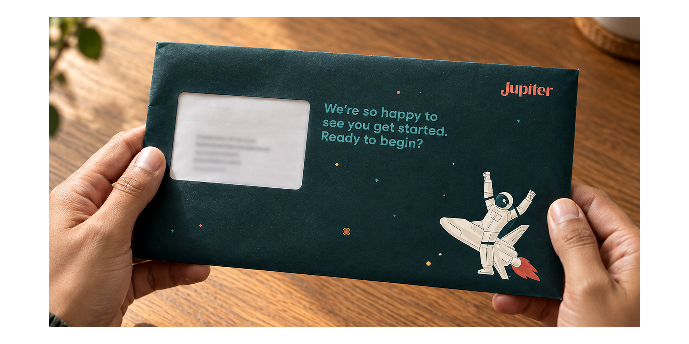
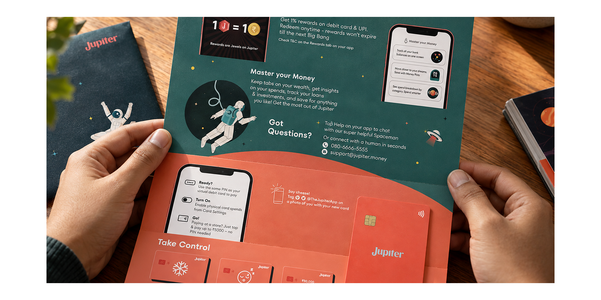
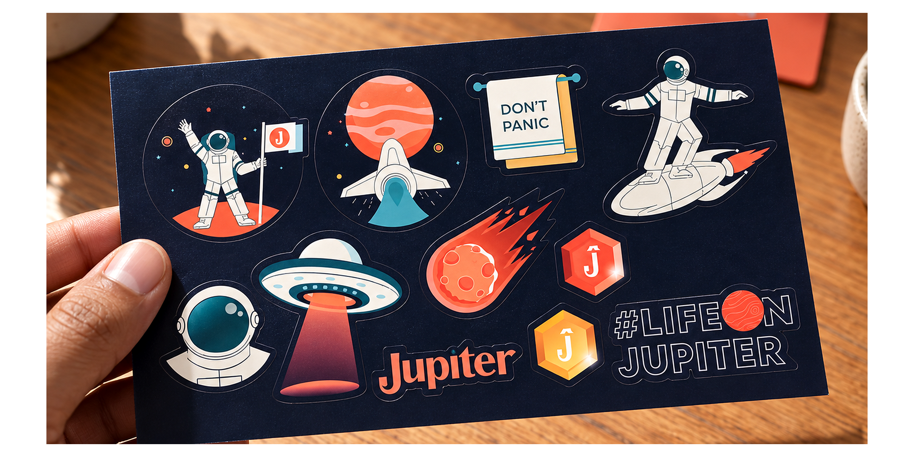
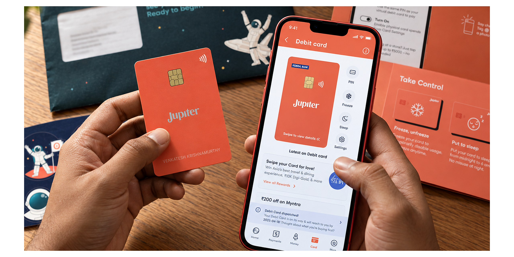
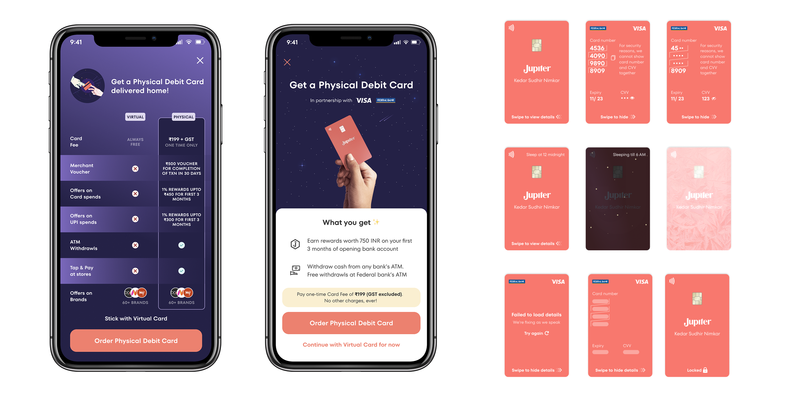
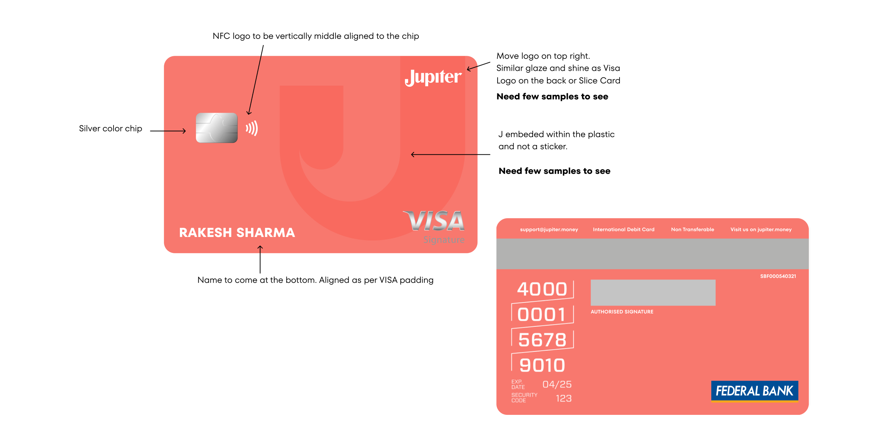
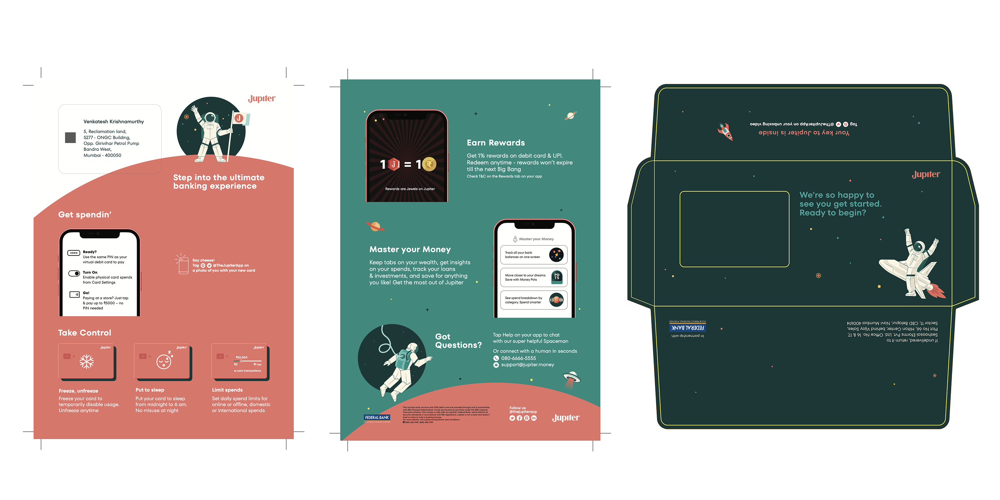
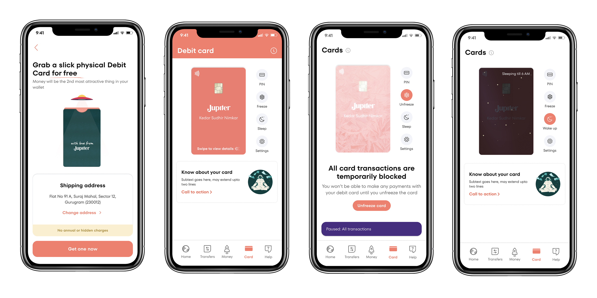

---
# Pulled from Notion "Patterns Work Blog Posts" (page 411226b9a26e8059b1cff11f83fc764d), 2026-11-09.
order: 4
client: Jupiter Money
title: Design beyond screens. CSAT up 46 Points.
description: "A beautiful debit card experience was becoming an operational nightmare. We redesigned everything from packaging to app activation, improving customer satisfaction, accelerating deliveries and helping Jupiter scale without compromising the experience."
publishedDate: 2026-11-09
ogImage: ./jupiter-debit-card-astronaut-phone-and-card.png
ogImageAlt: Design beyond screens. CSAT up 46 Points.
logo: ./jupiter-logo.svg
industry:
  - Digital Banking
  - Fintech
duration: 3 months
live: "https://jupiter.money/products/"
scope:
  - Service Design
  - User Research
  - Product Design
  - Packaging Design
impact:
  - "CSAT improved from 38% to 64%."
  - "Delivery time dropped from 7 to 2 days."
  - "Card packing time reduced by 75%."
about: "Jupiter is an Indian digital banking platform making money management simpler and more intuitive for a new generation of customers."
situation: "Jupiter's premium debit card kit looked impressive but took eight minutes to pack and seven days to deliver. Manual processes, excessive packaging and inconsistent communication were creating operational bottlenecks and customer complaints."
task: "Make the entire debit card journey faster, simpler and scalable. Improve customer satisfaction and operational efficiency while maintaining a distinctive, consistent experience across physical and digital touchpoints."
action: "We studied dispatch operations, simplified packaging, redesigned the physical card and aligned the digital experience. Working across operations, product, banking and compliance, we removed unnecessary complexity without sacrificing brand appeal or security."
result: "CSAT rose from 38% to 64%. Delivery dropped from 7 to 2 days. Packing time fell from 8 to 2 minutes, while daily card orders grew from 2,500 to 6,000."
---

