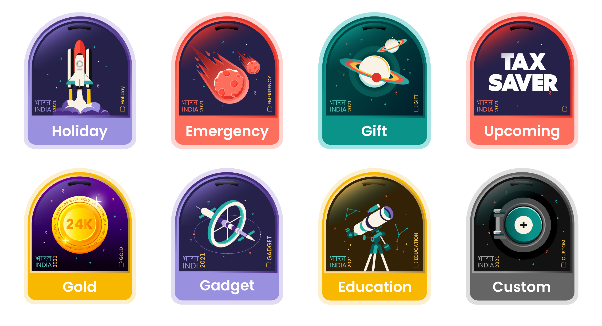
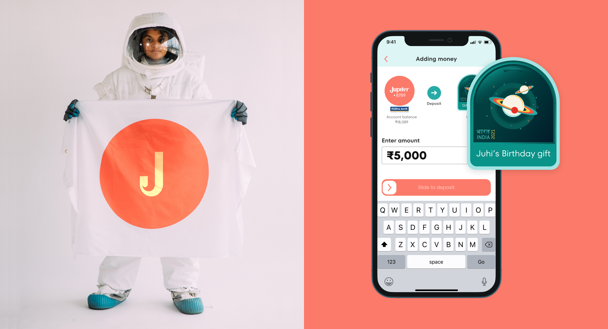
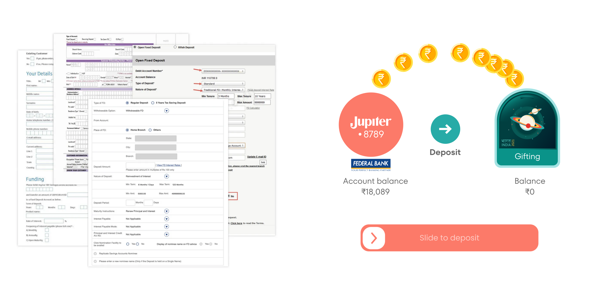
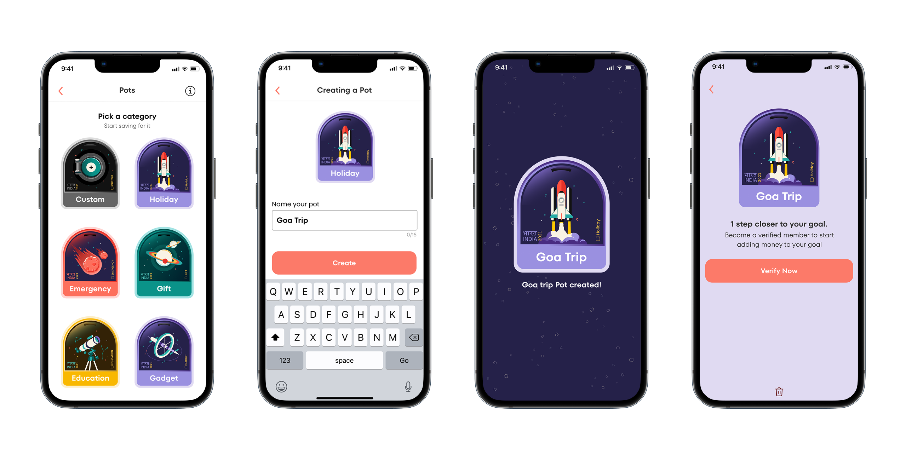
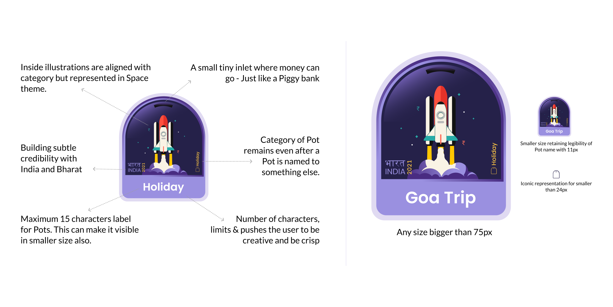
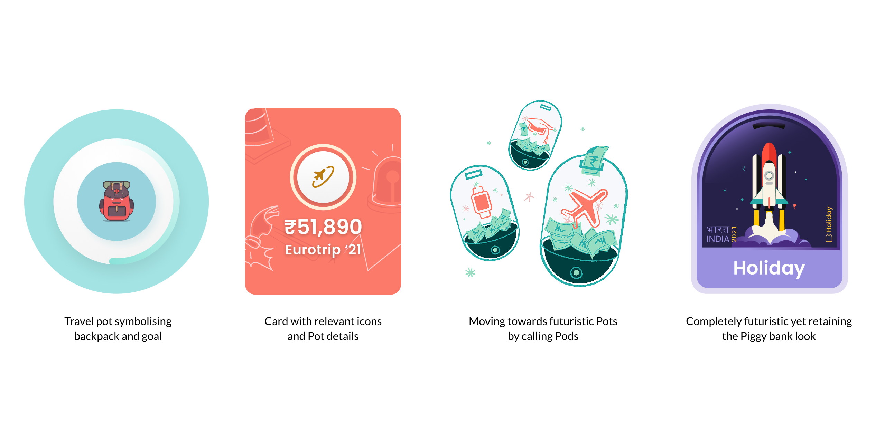
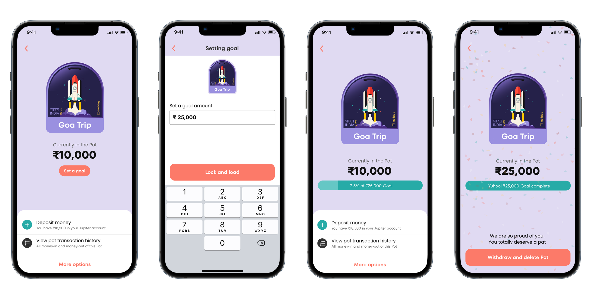
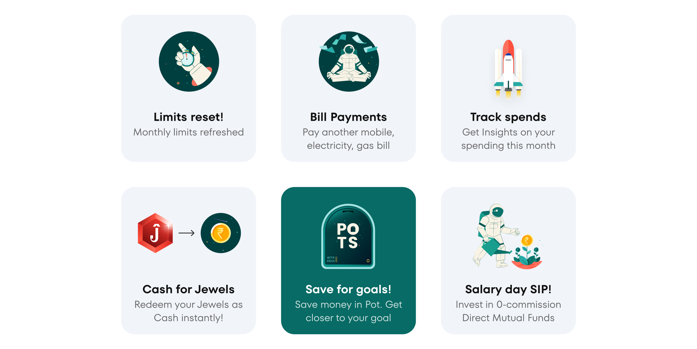
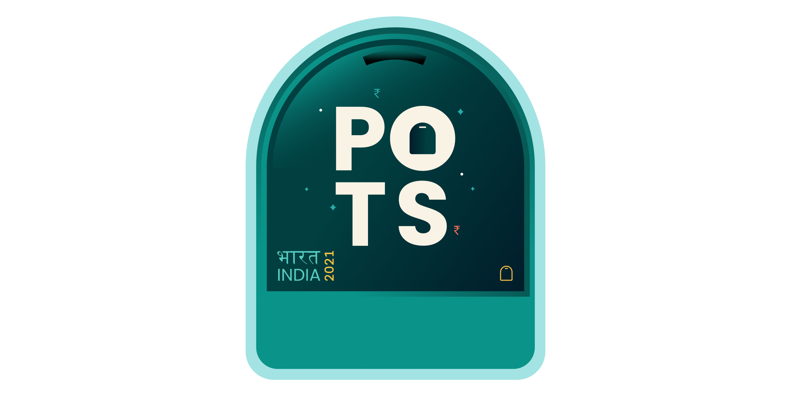

---
# Pulled from Notion "Patterns Work Blog Posts" (page 40b226b9a26e80c79ce8f4b27a26d9fc), 2026-11-07.
order: 2
client: Jupiter Money
title: Better experience matters for better business
description: "We reimagined traditional savings products to make saving personal, visual and rewarding. A product that changed saving behaviour and became one of Jupiter's most recognisable features."
publishedDate: 2026-11-01
ogImage: ./jupiter-pots-gift-holiday-education.png
ogImageAlt: Three Jupiter Pots, Gift, Holiday and Education, each an arched badge with a space illustration, on coral.
logo: ./jupiter-logo.svg
industry:
  - Fintech
duration: 6 weeks
live: "https://jupiter.money/pots/"
scope:
  - Product Strategy
  - User Research
  - Product Design
  - Visual Design
impact:
  - "6,467 Pots created in month one."
  - "23% increase in savings per account."
about: "Jupiter is a digital banking platform built for India's millennials and Gen Z, rethinking how a new generation manages, spends and saves money."
situation: "Fixed deposits were built for a generation that saved out of fear. Younger Indians saved with specific ambitions, yet traditional banking offered rigid products, complicated processes and little sense of progress."
task: "Rethink the savings experience around people's goals, not banking products. Make saving intuitive, personal and motivating while navigating the technical and regulatory complexities of the banking system."
action: "We replaced complex banking forms with a simple, visual experience. Users could create personalised Pots in under 30 seconds, track progress towards their goals and save for things that mattered to them."
result: "6,467 Pots created in the first month. Over 3,000 custom Pots. Savings per account increased 23%, with over 30% of users setting goals. Pots became one of Jupiter's signature products."
---

