---
# Pulled from Notion "Patterns Work Blog Posts" (page 40b226b9a26e80c79ce8f4b27a26d9fc), 2026-11-01.
order: 2
brand: Jupiter
title: "6,467 Pots in a month: Savings, redesigned for Gen Z"
description: "How Jupiter Pots turned a rigid fixed deposit into goal-based saving: 6,467 Pots in month one and 23% more savings per account."
publishedDate: 2026-11-01
ogImage: ./jupiter-pots-gift-holiday-education.png
ogImageAlt: Three Jupiter Pots, Gift, Holiday and Education, each an arched badge with a space illustration, on coral.
logo: ./jupiter-logo.svg
# From the Notion columns (Client is empty). Short values first, long ones last.
facts:
  - { label: Industry, value: Fintech }
  - { label: Time frame, value: 3 month (Nov 2021) }
  - { label: Role & Responsibilities, value: VP of Design }
  - { label: View work, value: "https://jupiter.money/pots/", href: "https://jupiter.money/pots/" }
  - label: Scope
    value:
      - Identity Design
      - Product Marketing
      - Communication strategy
  - label: Impact
    value:
      - "Pots created in 1st Month: 6,467"
      - "Custom Pots Created: 3,000+"
      - "Average balance in Pots: ₹1,200"
      - "Savings per account increased by: 23%"
      - "Percentage of users who set goals: 30%+"
---

Jupiter is a digital bank for India’s millennials and Gen Z. Before founding Patterns Studio, Kedar Nimkar led design there as VP of Design.

Young Indians were saving with a goal in mind. Their bank wasn’t built for it.

Fixed deposits were designed for a generation that saved out of fear, with lock-in periods, maturity instructions and interest payment modes. In Jupiter’s research, 82% found them too rigid, 52% forgot which money was meant for which goal, and 41% had spent goal money by accident. Jupiter needed a way to save that felt like progress.

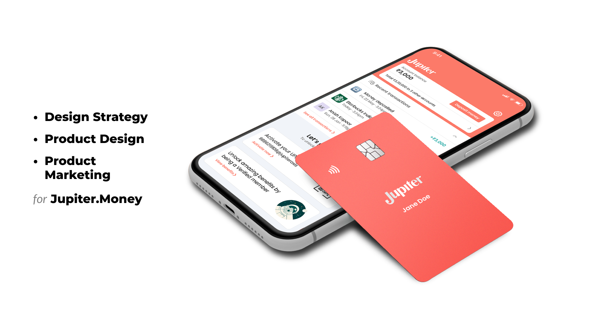

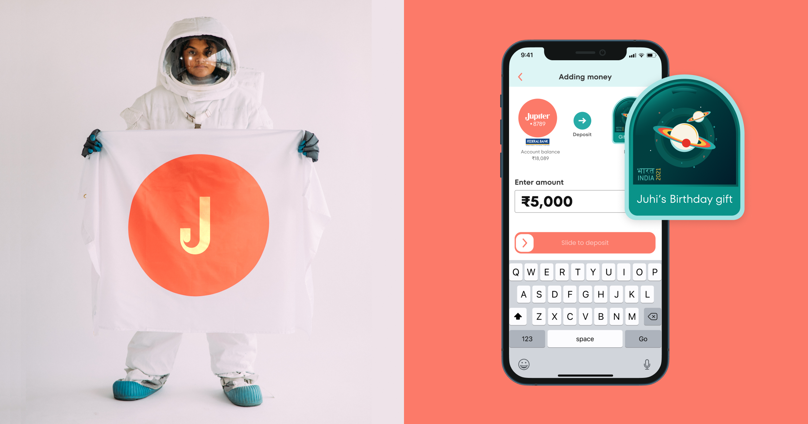

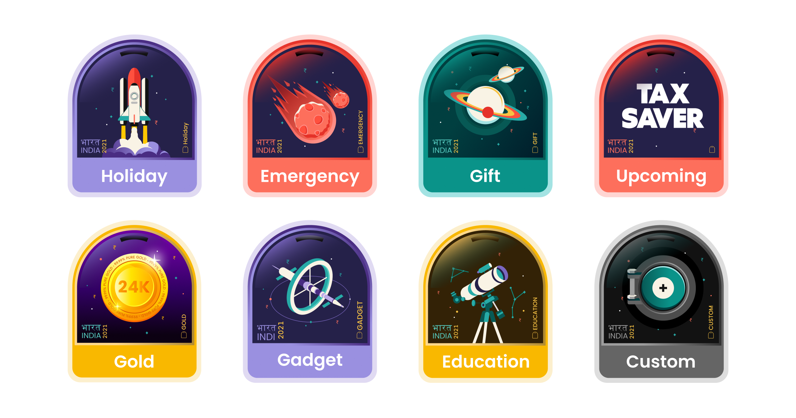

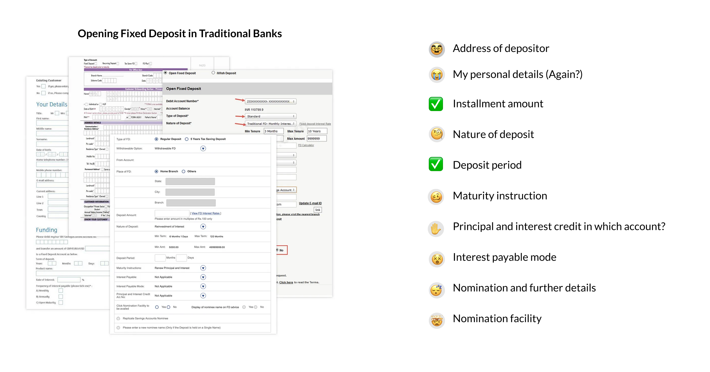

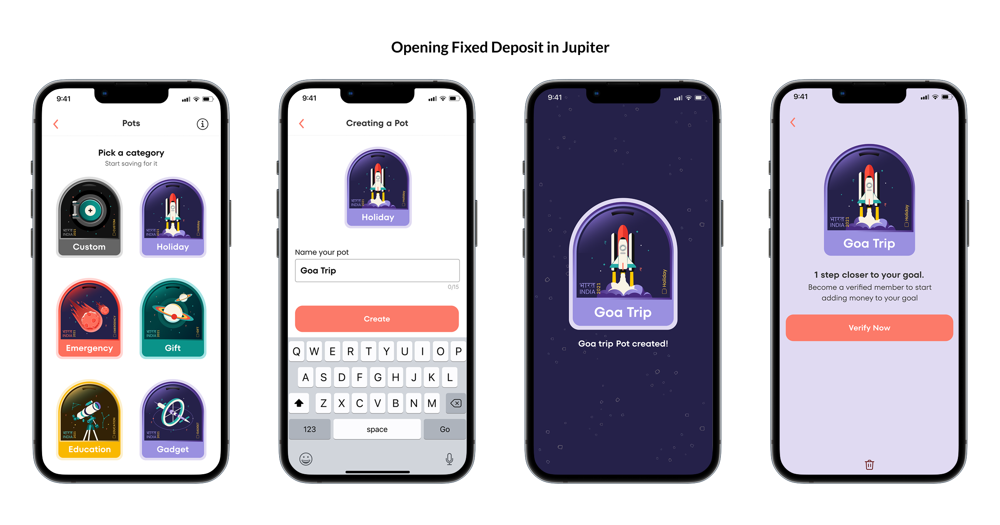

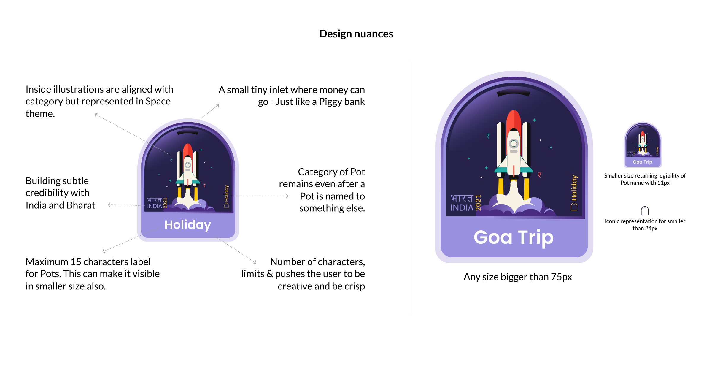

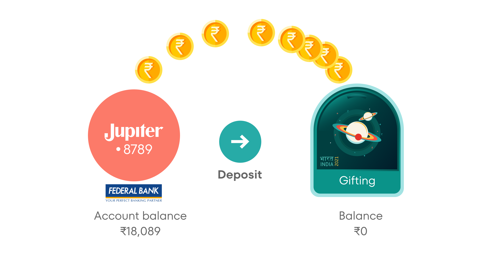

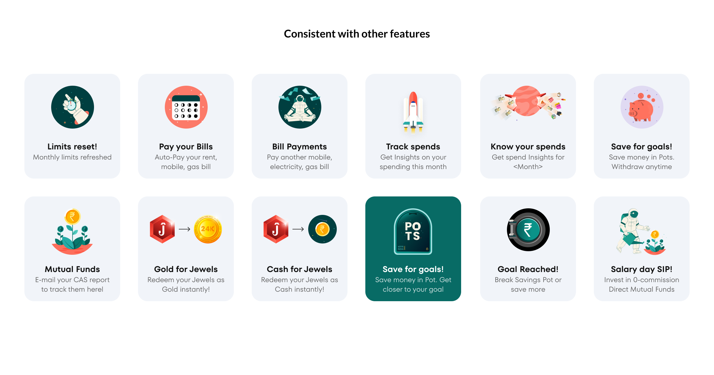

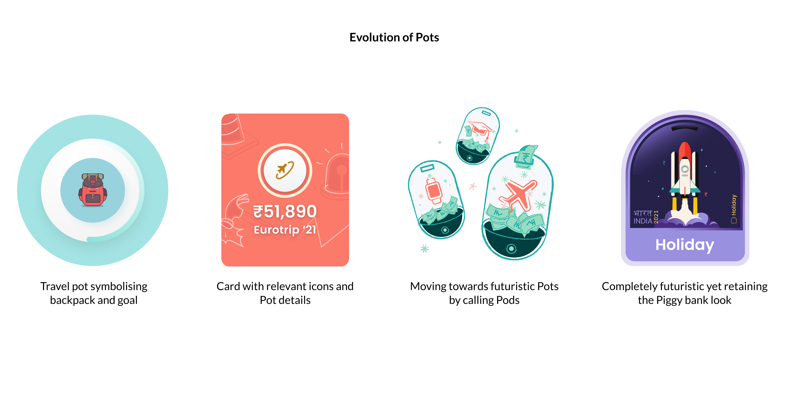

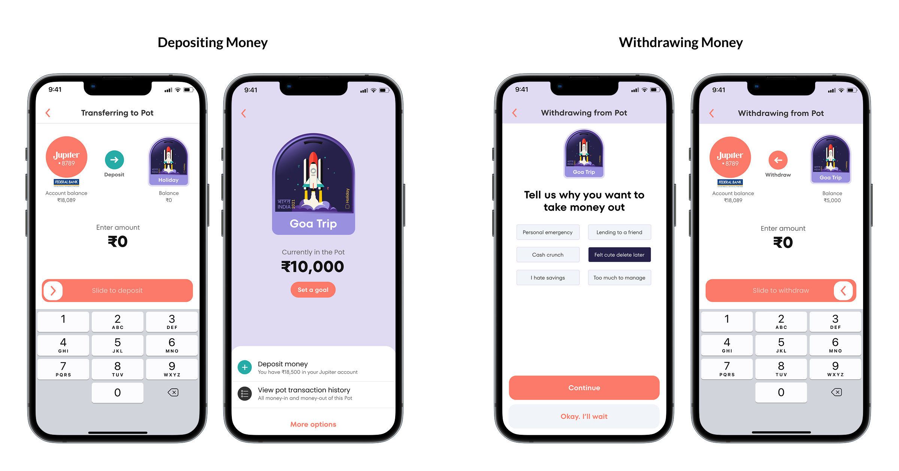

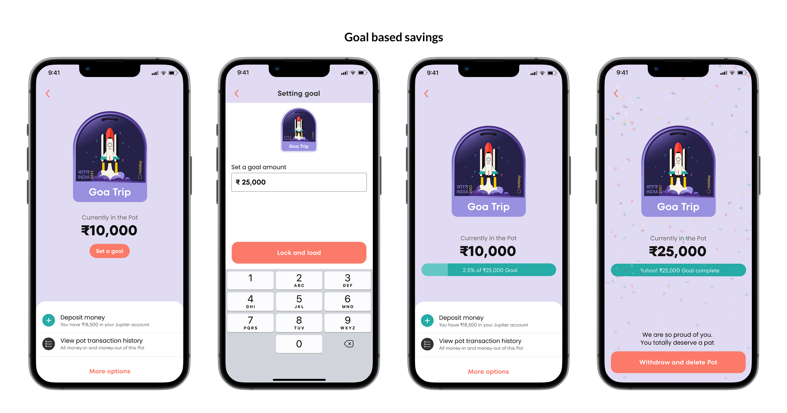

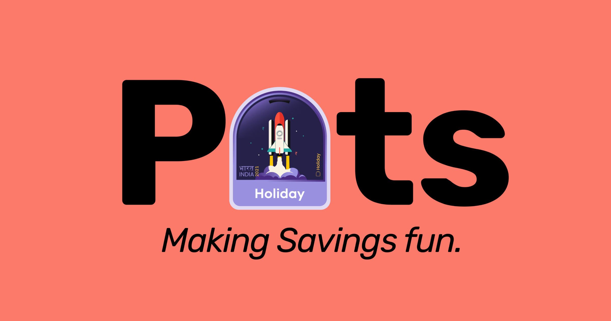

## About the project

The research took one week: 12 interviews, an 800-person survey through Jupiter’s Telegram community and a 1,200-person study across eight cities. 76% of users already saved with a specific goal in mind. Their parents saved because tomorrow was uncertain. They saved because they knew exactly what tomorrow looked like.

Regulation required every Pot to have its own sub-account at Federal Bank, Jupiter’s banking partner. The quicker route was to show some of that to the user. The design team negotiated with product, engineering, legal, marketing and the bank to keep it out of sight.

What users got was three steps: pick a category, name it, done, in under 30 seconds. The name stops at 15 characters, on purpose. Goa Trip. New Mac. Mango’s Vet. A short, specific name made the money belong to something real.

The Pot itself was drawn to be recognised at any size: a coin slot at the top like a piggy bank, a space illustration for each category, and a small India and Bharat mark. It works as a 75px hero and as a 24px notification icon.

In the first month, users created 6,467 Pots, more than 3,000 of them custom. Savings per account rose 23%, and over 30% of users set goals. Then they asked for something the research said they wouldn’t want: a way to lock their own money until they reached the goal.

### Pots went on to become Jupiter’s most recognisable feature and its strongest marketing asset, used in the app, in campaigns and on social.

That is what Kedar brings to Patterns Studio clients: design that handles the complexity behind the scenes and shows up as growth in the numbers.
