---
# Pulled from Notion "Patterns Work Blog Posts" (page 40a226b9a26e801aa9b1f286c640922e), 2026-11-01.
order: 1
brand: Neufin
title: Neufin Energy - Electrifying brand identity
description: Neufin Energy helps Indian businesses buy cheaper, cleaner power. A brand refresh, design system and website by Patterns Studio, built AI-first.
publishedDate: 2026-11-01
ogImage: ./neufin-energy-website-on-laptop-and-phone.png
ogImageAlt: The new Neufin Energy website on a laptop and a phone, with the headline "Cut Energy Cost. On Your Terms."
logo: ./neufin-energy-logo.svg
# From the Notion columns Client, Industry, Time frame, View work, Scope (short values first, long ones last).
facts:
  - { label: Client, value: Neufin Energy }
  - { label: Industry, value: Climate Tech }
  - { label: Time frame, value: 1 month (October 2026) }
  - { label: View work, value: "https://neufin.energy/", href: "https://neufin.energy/" }
  - { label: Scope, value: "Identity Design, Brand Storybook, Communication strategy and Marketing website" }
---

Neufin Energy helps Indian businesses buy cheaper, cleaner power from solar, wind, battery storage and the power exchange, and tracks every unit with its own software, Lumen.

The services and offerings are strong. The brand wasn’t carrying it.

As like any startup, the founders were focused on business, finding product market fit, and generating leads. **This had left the logo, website and sales deck telling different stories.** Buyers took Neufin for one more consultant, or compared it with its own partners. The story only landed when a founder was in the room.

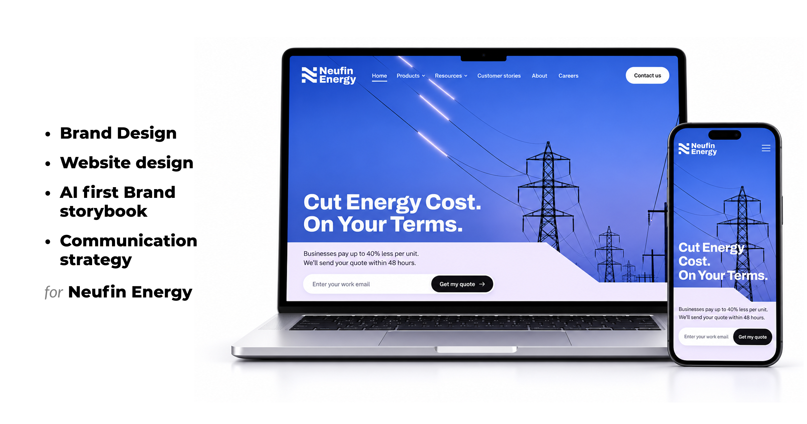

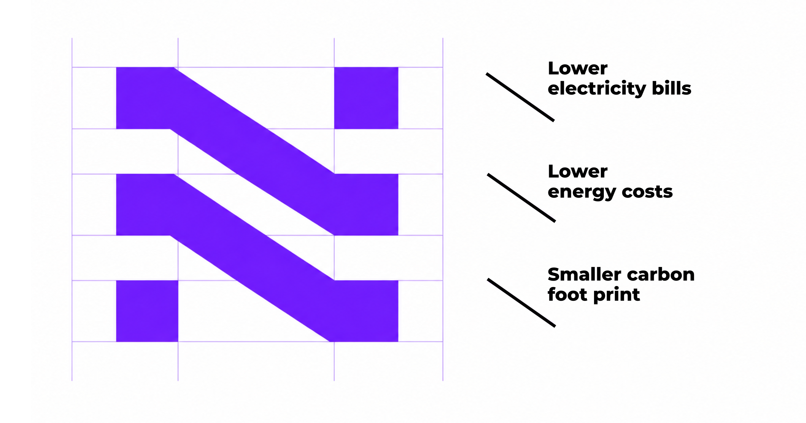

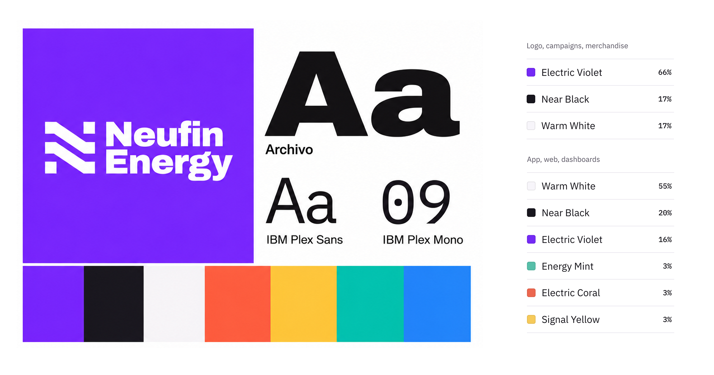

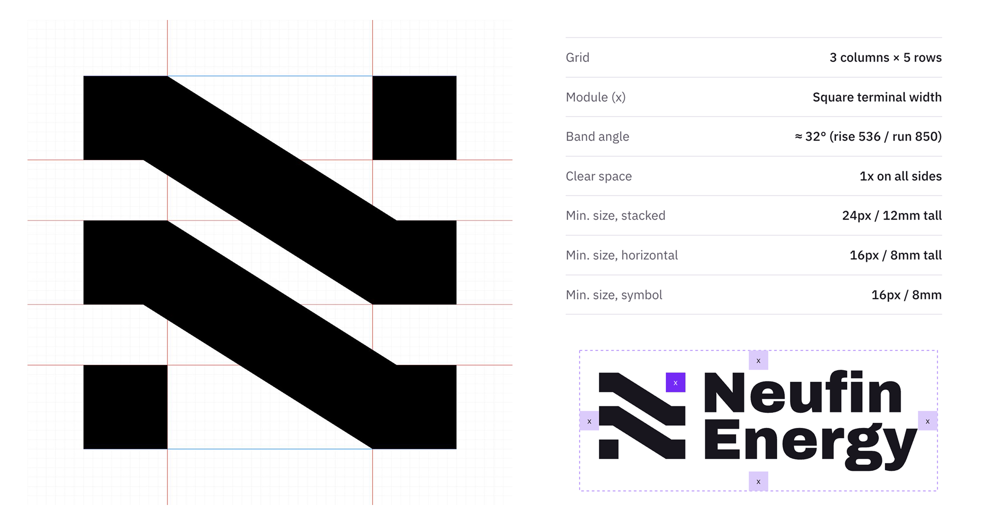

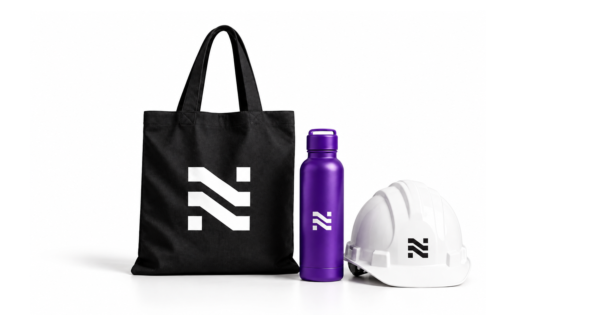

")

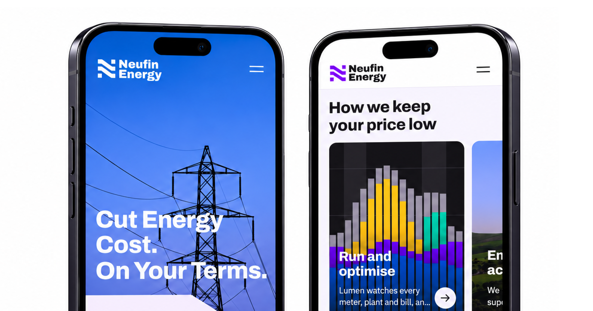

We designed the website in the browser and built it in Next.js on Neufin’s design system, which also holds the brand storybook. Around it are tools the team can use without a designer: a social post builder, an illustration prompt builder that turns an idea into an on-brand ChatGPT prompt, an icon set and a sales deck template.

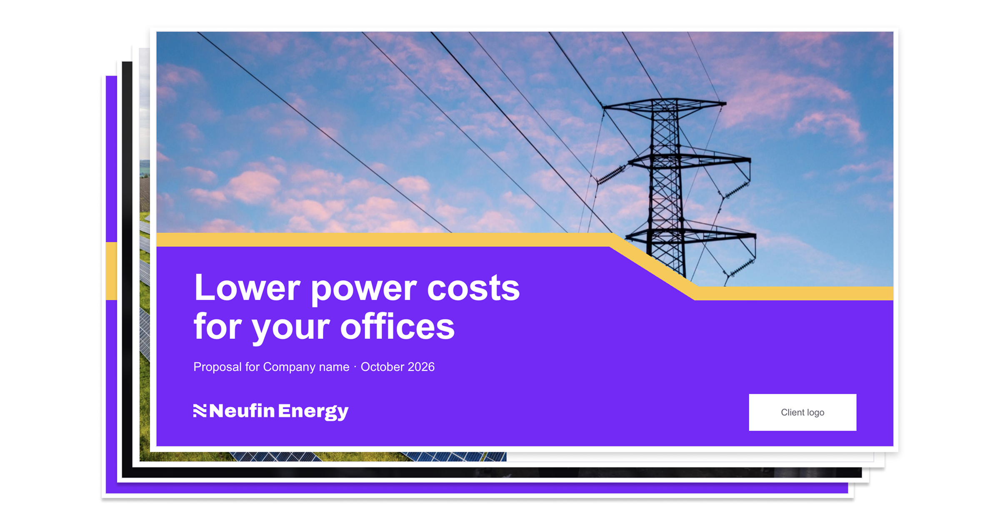

Neufin Energy now tells one story on its website, in its sales deck and in every post, and its team has the tools to keep it consistent as the company grows.

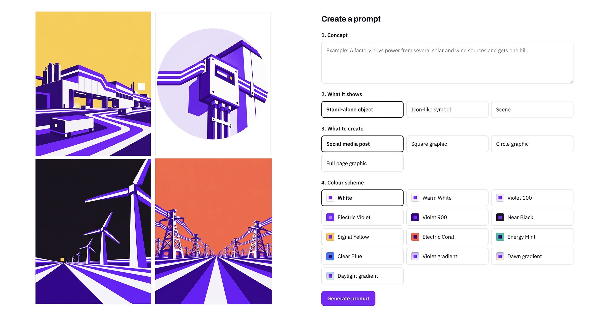

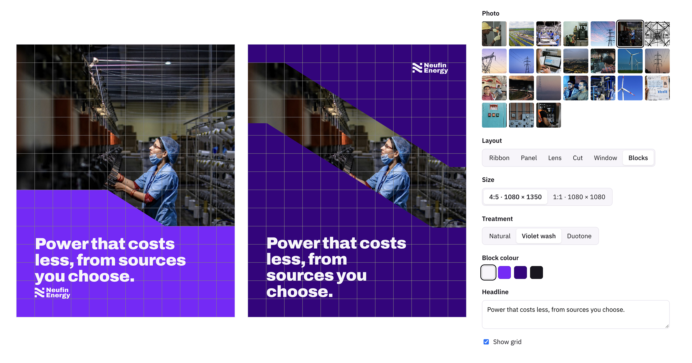

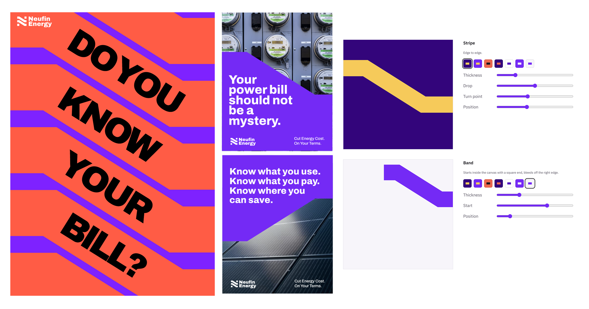

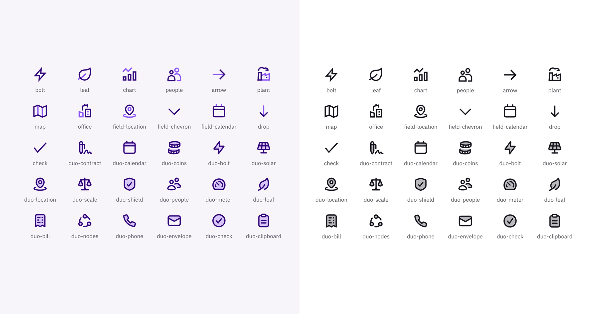

## About the project

Neufin Energy as a platform and service isn’t sold to one person. A plant head or finance manager brings it in, puts their name on it, and passes the case up to a CFO who has never met the team. Every meeting made the story weaker and landed in chinese whisper.

This not only put brand at risk but also wasted lot of founder’s time in closing deals.

The unlock was in how these buyers decide. They don’t buy energy on aspiration. They buy it on obligation, and they need proof they can forward. So we built a brand that is easy to repeat: plain words, real numbers, and one line for every slide. Cut Energy Cost. On Your Terms.

The symbol draws that promise. An N made of three bands stepping down at 32 degrees, one each for a lower bill, lower energy costs and a smaller carbon footprint. That one angle runs through everything: the Stripe that crops photographs and frames posters, the illustrations, the plan marks, the website.

Now with the new branding, website and the entire story around the brand - the founders are confident rallying their sales team behind one story, told the same way in every meeting.

The investors have seen the new brand and are loving it. And because the systems are in place, the brand can keep evolving with the company. We’re looking forward to seeing how it lands in the market.
