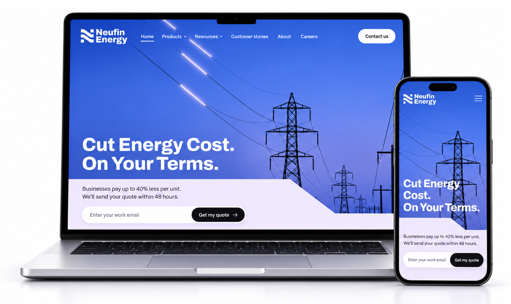
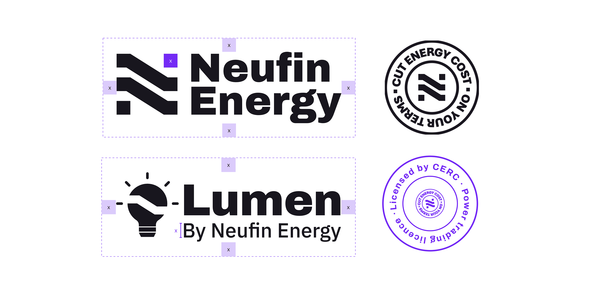
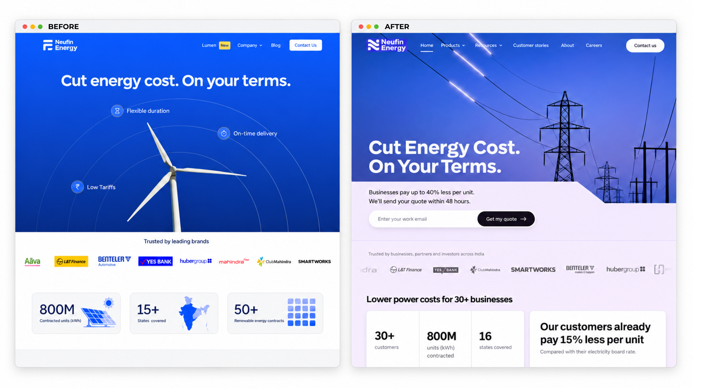
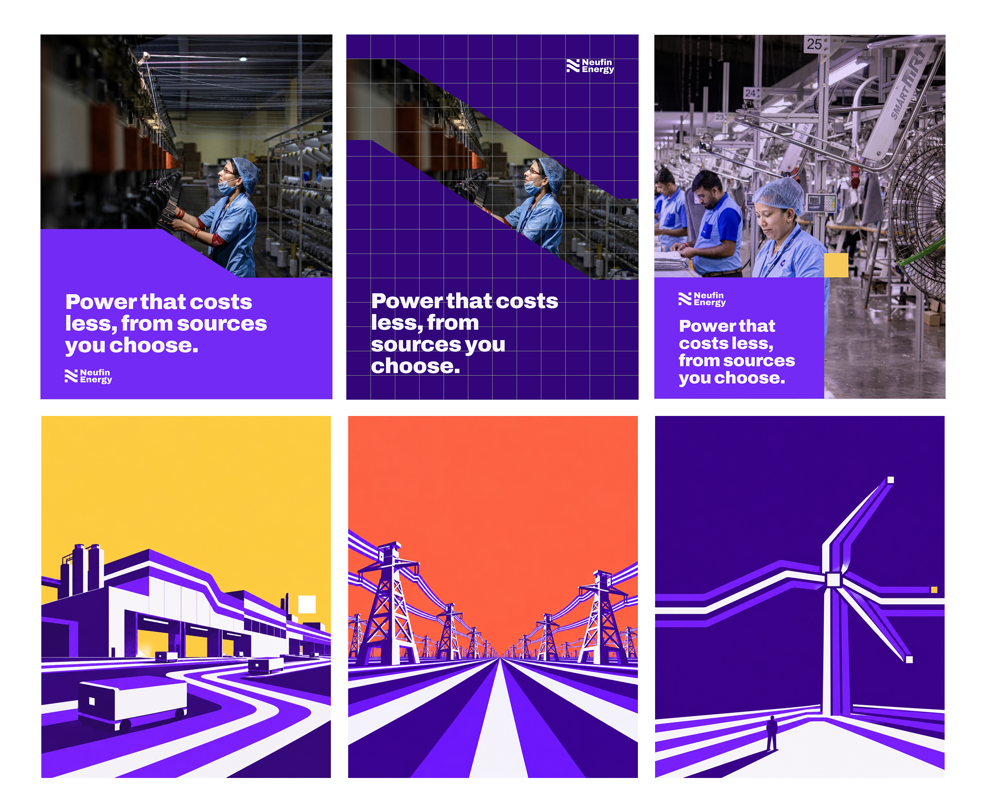
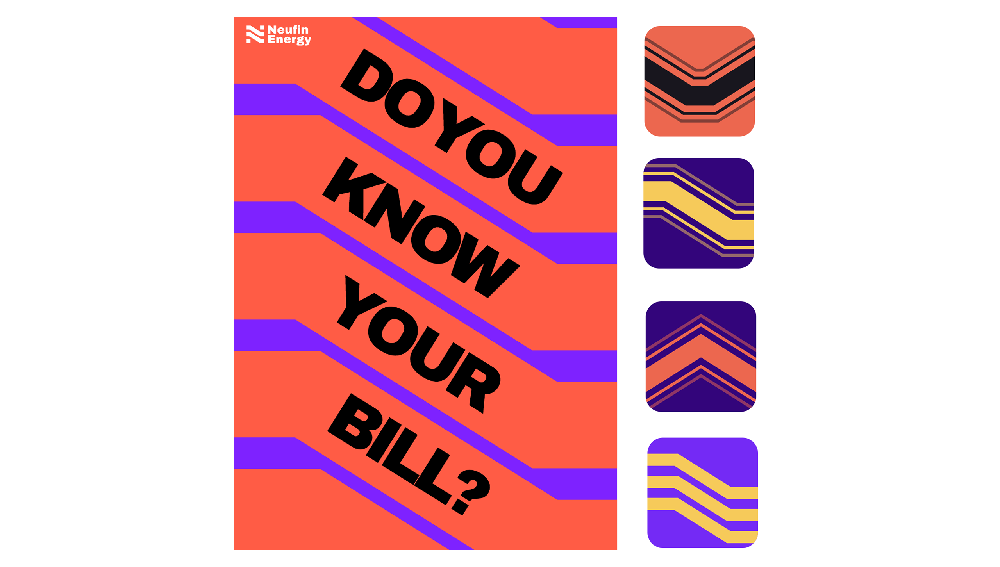
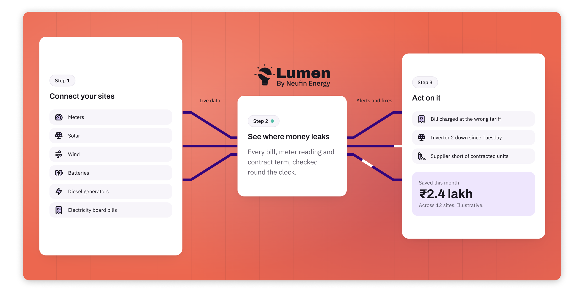

---
# Pulled from Notion "Patterns Work Blog Posts" (page 40a226b9a26e801aa9b1f286c640922e), 2026-11-05.
order: 1
client: Neufin Energy
title: Neufin Energy - Electrifying brand identity
description: Neufin Energy helps Indian businesses buy cheaper, cleaner power. A brand refresh, design system and website by Patterns Studio, built AI-first.
publishedDate: 2026-11-01
ogImage: ./neufin-energy-website-on-laptop-and-phone.png
ogImageAlt: The new Neufin Energy website on a laptop and a phone, with the headline "Cut Energy Cost. On Your Terms."
logo: ./neufin-energy-logo.svg
industry: Climate and Energy
live: "https://neufin.energy/"
scope:
  - Identity Design
  - Brand Storybook
  - Communication strategy
  - Marketing website
  - Ongoing work
testimonial: "Kedar thought outside the box, bringing the “X⁠-⁠factor” we needed for a distinctive brand architecture."
---

## About Neufin

Neufin Energy helps Indian businesses buy cheaper, cleaner power from solar, wind, battery storage and the power exchange, and tracks every unit with its own software, Lumen.

The services and offerings are strong. The brand wasn’t carrying it.

As like any startup, the founders were focused on business, finding product market fit, and generating leads. This had left the logo, website and sales deck telling different stories. Buyers took Neufin for one more consultant, or compared it with its own partners. The story only landed when a founder was in the room.

## About the project

Neufin Energy as a platform and service isn’t sold to one person. A plant head or finance manager brings it in, puts their name on it, and passes the case up to a CFO who has never met the team. Every meeting made the story weaker and landed in chinese whisper.

This not only put brand at risk but also wasted lot of founder’s time in closing deals.

The unlock was in how these buyers decide. They don’t buy energy on aspiration. They buy it on obligation, and they need proof they can forward. So we built a brand that is easy to repeat: plain words, real numbers, and one line for every slide. Cut Energy Cost. On Your Terms.

The symbol draws that promise. An N made of three bands stepping down at 32 degrees, one each for a lower bill, lower energy costs and a smaller carbon footprint. That one angle runs through everything: the Stripe that crops photographs and frames posters, the illustrations, the plan marks, the website.

Now with the new branding, website and the entire story around the brand - the founders are confident rallying their sales team behind one story, told the same way in every meeting.

The investors have seen the new brand and are loving it. And because the systems are in place, the brand can keep evolving with the company. We’re looking forward to seeing how it lands in the market.
