---
# Pulled from Notion "Patterns Work Blog Posts" (page 417226b9a26e80ccaef7cd3069ac27fa), 2026-11-13.
order: 6
client: "Payments Council of India (PCI)"
title: A shared visual language for India’s payments
description: "Every payment app drew “send money” differently. We helped build Project Pratima, India’s first standard library of payment icons, so a user who learns one app can confidently use them all."
publishedDate: 2026-11-13
ogImage: ./project-pratima-card.png
ogImageAlt: "Grid of standardised payment icons from Project Pratima, including send money, scan QR and transaction status, drawn on a 24px grid."
logo: ./government-of-india-logo.png
industry:
  - Fintech
  - Digital Banking
  - Public Infrastructure
duration: 3 months
live: "https://paymentscouncil.in/project-pratima/icons/"
scope:
  - User Research
  - Visual Design
  - Identity Design
  - Marketing website
  - Icon system design
impact:
  - "A shared, open-source icon standard for India’s payment ecosystem, made with Amazon Pay, Paytm, NPCI, HDFC Bank, SBI, Visa, WhatsApp Pay and others. The aim is to make payments easier to read and harder to fake."
about: "The Payments Council of India represents India’s non-bank payment companies, including Paytm, PhonePe, Razorpay, PayPal and Juspay. It works with regulators to make digital payments more inclusive and trusted."
situation: "Millions of first-time users in India move money by recognising icons, not reading labels. Each app used different symbols for the same action, which caused confusion, broke trust and left room for fraud."
task: "Create one icon set that works across every brand, language and literacy level. It had to be recognisable without labels, accessible to screen readers and free for anyone to adopt."
action: "We audited icons across apps and ran working sessions with banks, fintechs and NPCI. We then designed 12 core action icons on a 24px grid, with flexible stroke and radius rules so brands can adapt them without losing meaning."
result: "The library launched in December 2022 under the Apache 2.0 licence. It covers send, receive, scan QR, check balance, history and transaction status, and it’s open to every payment app in India."
---

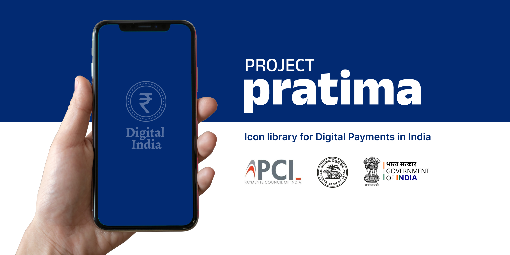

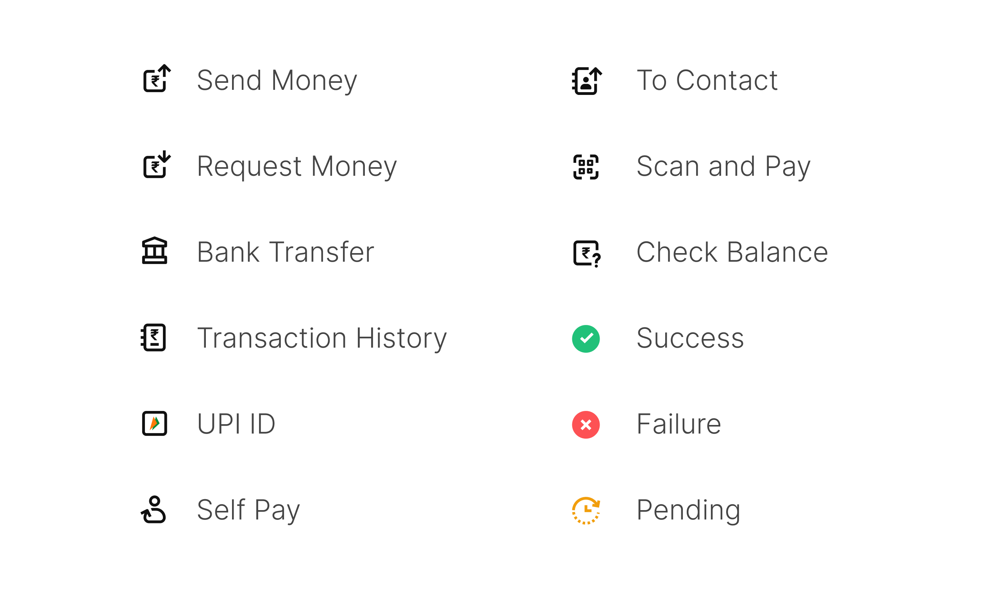

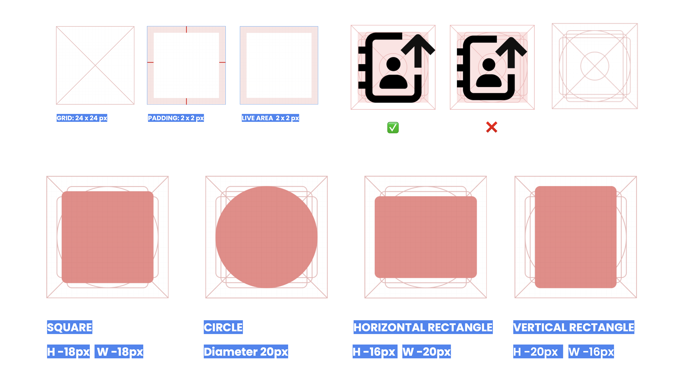

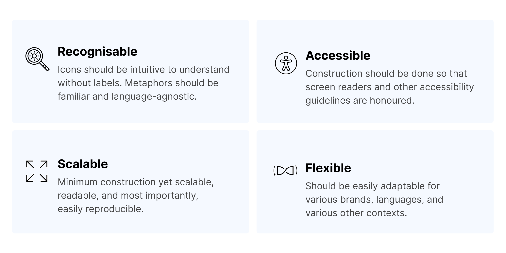

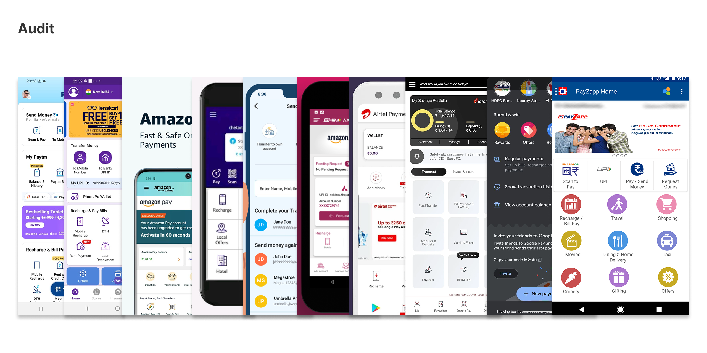

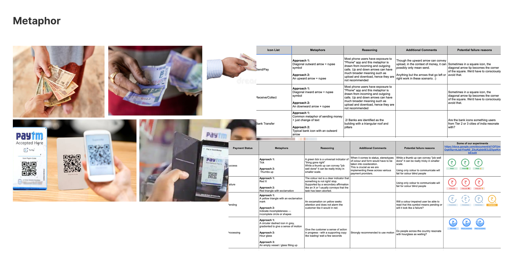

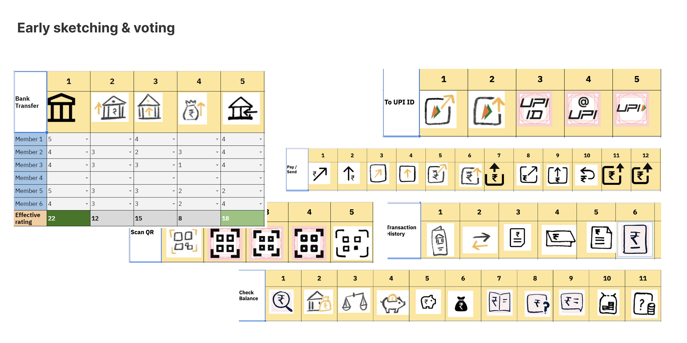

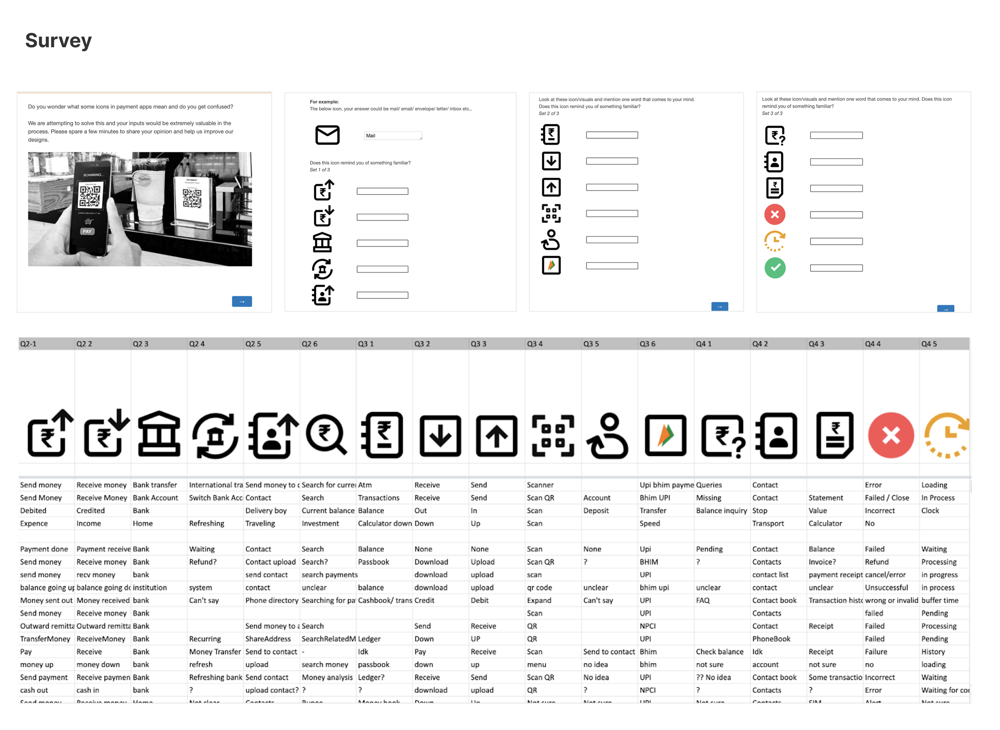

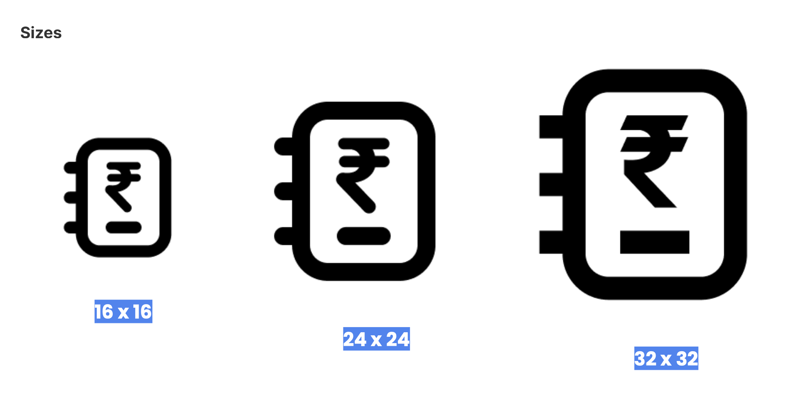

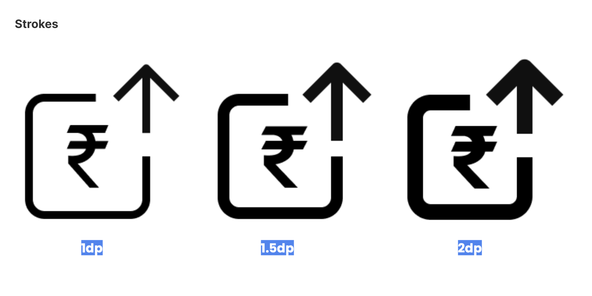

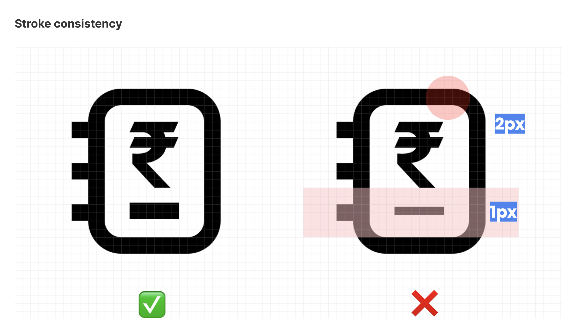

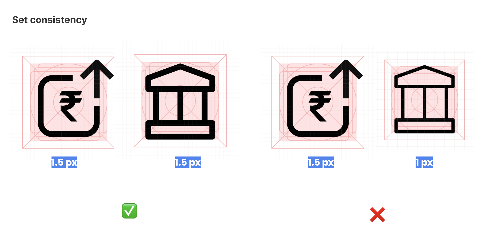

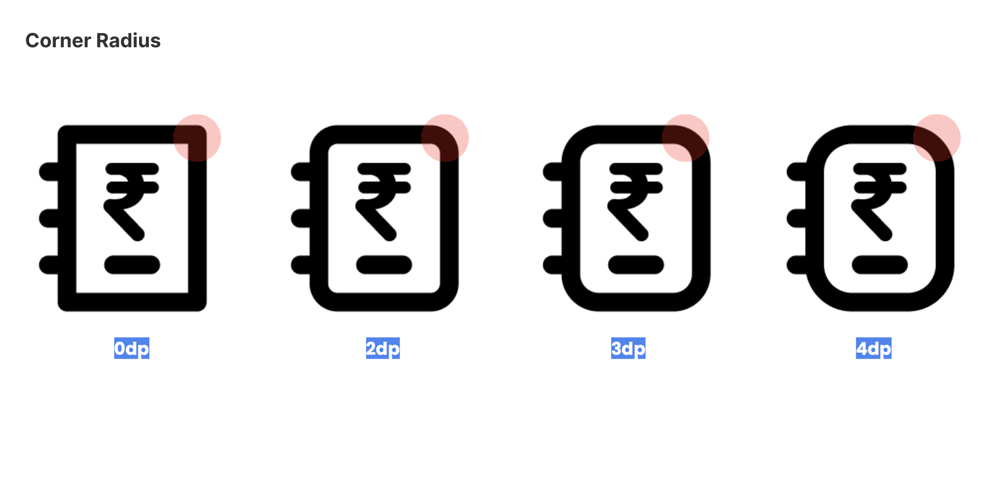

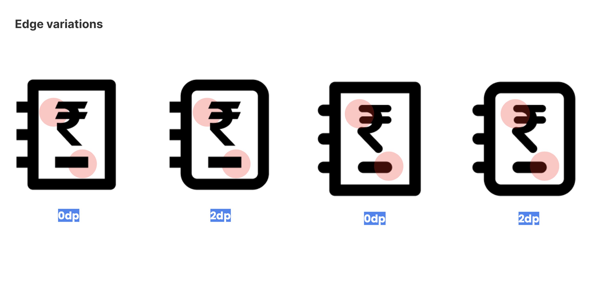

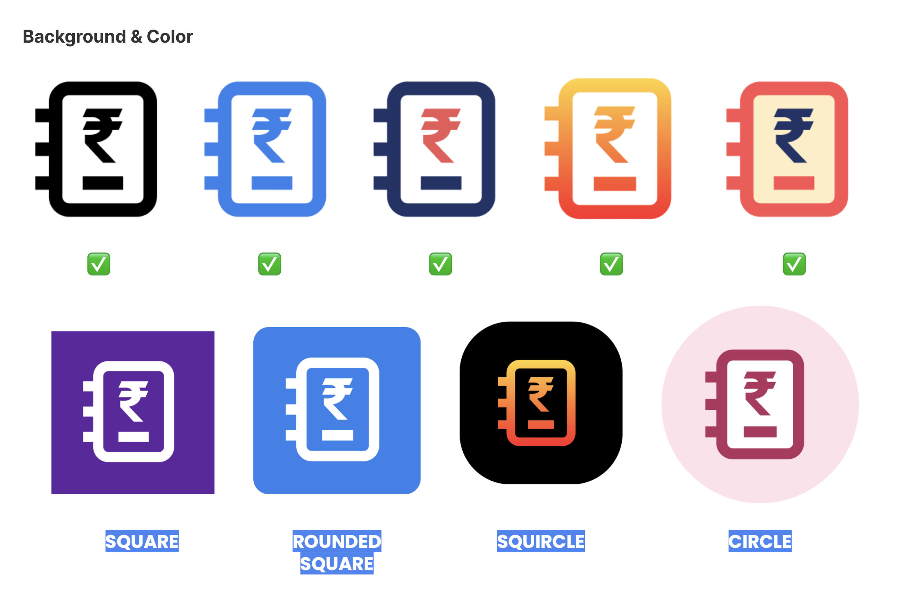
