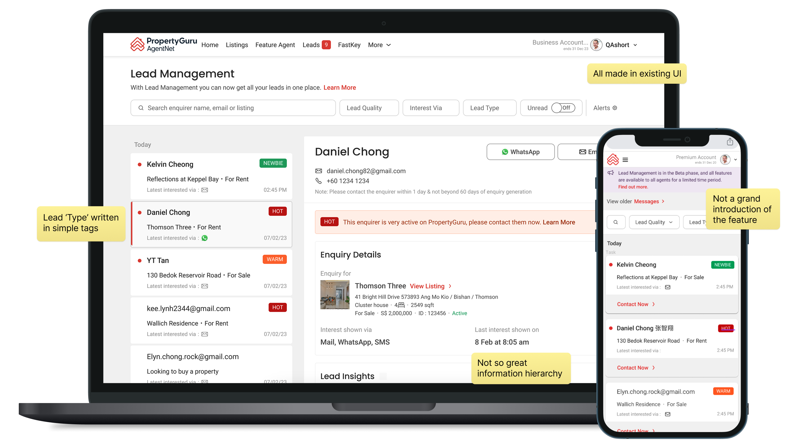
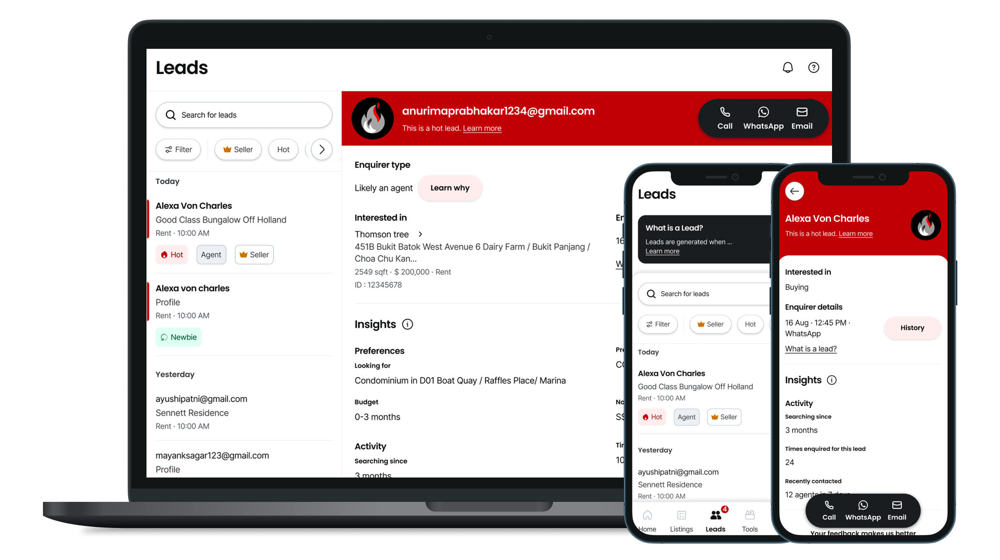
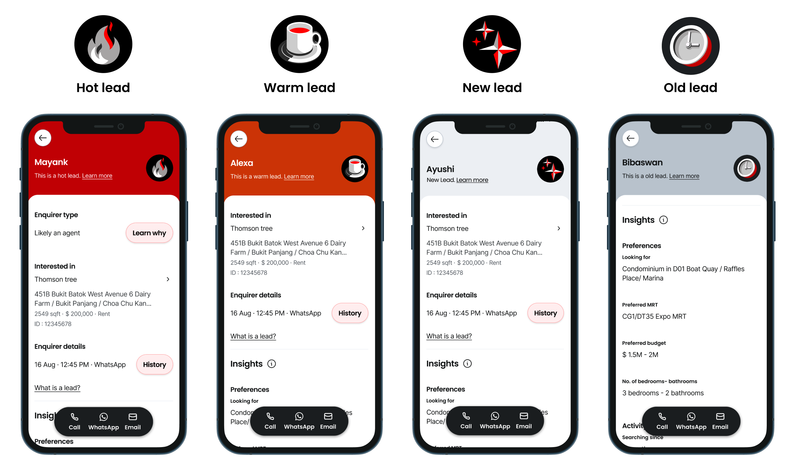
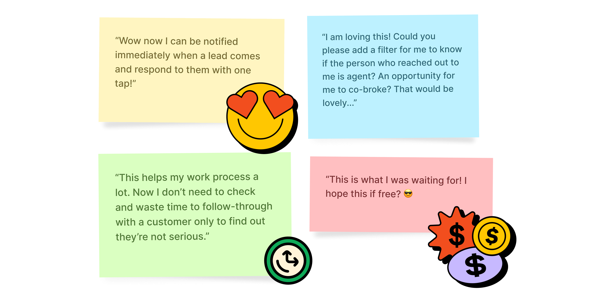
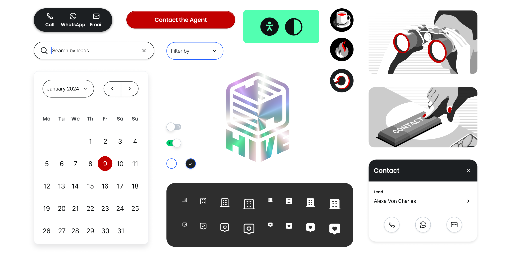
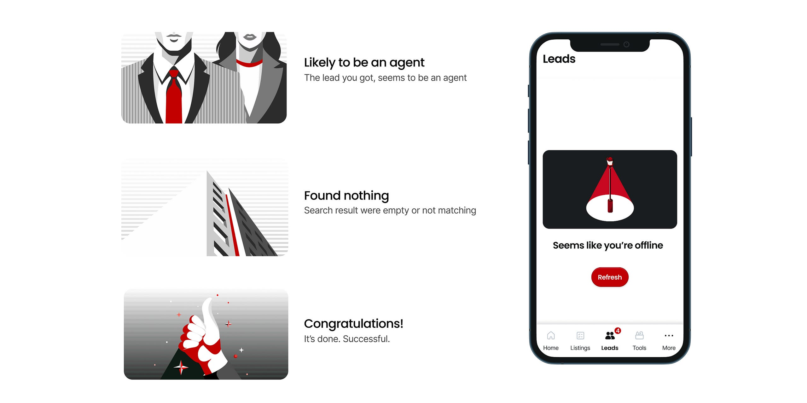

---
# Pulled from Notion "Patterns Work Blog Posts" (page 419226b9a26e80af80b0e964fac0f593), 2026-11-15.
# Logo: the site's PropertyGuru SVG (src/assets/companies/propertyguru.svg) instead of Notion's small PNG, so the cards pick up PropertyGuru red.
order: 7
client: PropertyGuru
title: Why did PropertyGuru agents ditch their spreadsheets?
description: "PropertyGuru agents were losing deals to scattered leads. We designed Lead Management, a mini-CRM in AgentNet putting every lead and next step in one place. Built on HIVE, it shipped redesigned on time; agents using it report 25% higher satisfaction."
publishedDate: 2026-11-15
ogImage: ./propertyguru-lead-management-card.png
ogImageAlt: "How did PropertyGuru agents ditch their spreadsheets?"
logo: ./propertyguru-logo.svg
industry:
  - Proptech
  - Real Estate
duration: 2 months
live: "https://www.agentofferings.propertyguru.com.sg/tools/lead-management/"
review: Jeremy Williams
scope:
  - Identity Design
  - Communication strategy
  - Product Marketing
  - Product Design
  - Visual Design
  - Icon system design
about: "PropertyGuru is Southeast Asia’s leading PropTech company, helping 30M+ property seekers monthly find homes across Singapore, Malaysia, Vietnam and Thailand, and the agents who serve them."
situation: "PropertyGuru’s agents juggled leads across sticky notes, calendars and spreadsheets. With hundreds of enquiries arriving and little context on each, prioritising was guesswork. Good leads went cold, home seekers waited too long, and agents lost deals they should have closed."
task: "Design Lead Management, a mini-CRM inside AgentNet that puts every PropertyGuru lead in one place. It had to help agents decide who to call first, keep notes together, and act on each lead with clear next steps."
action: "We shipped a fast first version, tested it with Singapore power users, then rebuilt it on HIVE, our new design system. Ready-made React components let us redesign the whole product, with new iconography and illustrations, without moving the launch date."
result:
  - 25% higher agent satisfaction
  - Used by more than 60% of agent partners
  - One clear view of every lead and what to do next
---

https://www.youtube.com/watch?v=QsTCZJVqpfg
