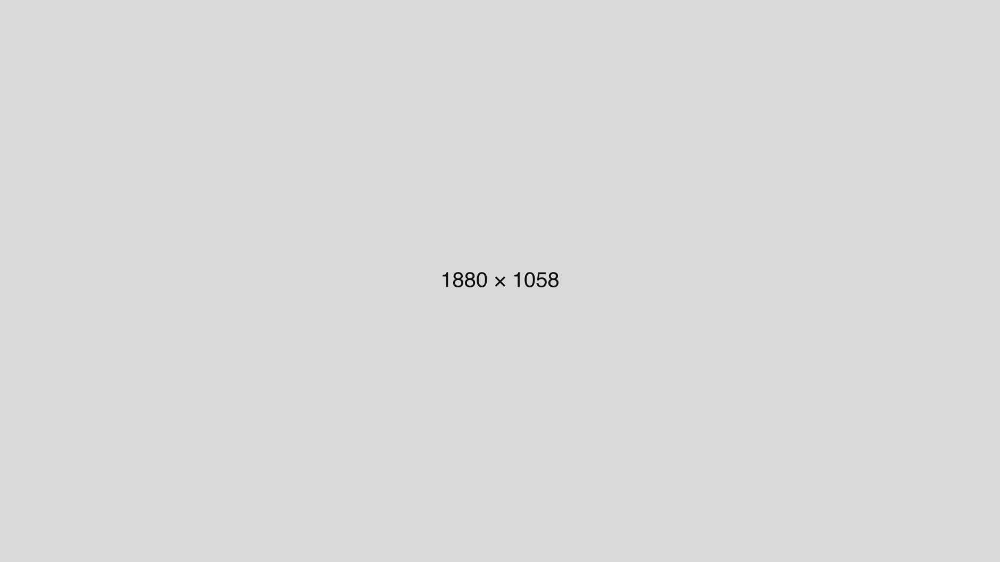

## Section header

**Paragraph - dummy text** - Spotify changed their flat logo to a disco-ball image for their 20th anniversary and the internet started talking about a new “disco-morphism trend”.

As someone who coined two morphisms already (neumorphism and glassmorphism), let me break it down for you and explain why I stopped naming new morphism and why you probably should too.

There is only one exception to this rule.

A truly interesting trend that hasn’t been fully figured out yet, so there’s potential for both innovation and obscurity. And another one that has a lot less use-cases, but can be extremely refreshing for some products.

### Section header

- Ordered and unordered list
- Ordered and unordered list
  - Nested item

1. Ordered and unordered list
2. Ordered and unordered list

> Center aligned Pull quote. A sentence worth pulling out of the story.
>
> — Person name

## Section header

Paragraph with [a link](../) and *italic text*.

| Table heading | |
| --- | --- |
| Row | Value |
| Row | Value |
| Row | Value |

Paragraph after a table.

---

## Section header

Paragraph after a divider.
